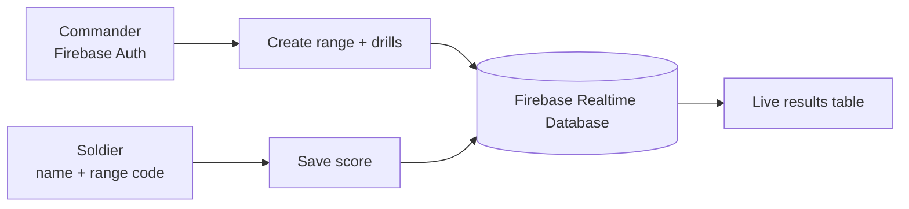

# IdfRangeApp

An Android app that replaces the paper score sheet at a shooting range. Each soldier enters their own scores on their phone and the commander sees one live table for the whole group.

## The problem

At a range day, scores for every drill are written on paper and collected by hand. It's slow, sheets get lost, and the commander only sees the full picture after someone types everything up.

## What I built

A Java app backed by Firebase Realtime Database. The UI is in Hebrew.

- A commander signs in, creates a range with a code, and defines the drills (name and description)
- Soldiers join with their name and the range code, no account needed
- Each soldier picks a drill, reads its description and saves a score
- A table screen shows every soldier against every drill, updating live
- A screen with an instructional video on shooting positions

## Architecture

Database layout, per range:

| Path | Holds |
|---|---|
| `Range list/<range>` | Which range codes exist |
| `<range>/Drill list/<drill>` | Drill number and description |
| `<range>/<drill>/<name>` | Score, grouped by drill |
| `<range>/Name list/<name>/<drill>` | Score, grouped by soldier |
| `<range>/Global list/<name>` | One row per soldier for the table |

| Activity | Screen |
|---|---|
| `loginActivity` | Join a range, or sign in as commander |
| `newRangeActivity`, `drillsActivity` | Create a range and its drills |
| `scoreActivity` | Enter scores, see your own |
| `tableActivity` | Everyone's results |
| `positionsActivity` | Video |

## Design decisions

- Each score is written to three places, one per way it is read (by drill, by soldier, and as a table row). The Realtime Database has no joins, so the data is shaped for the screens that read it.
- Only the commander has an account. Soldiers type a name and a range code, so nobody has to register at the range. The range code works as a shared join secret.
- Screens listen to the database instead of polling, so the commander's table fills in as scores are saved.
- Name and range are remembered on the device, so reopening the app goes straight back to the same range.

## Building

Old toolchain: Android Gradle Plugin 4.2.2, Gradle 6.7.1, target SDK 30. Open it in Android Studio and accept the upgrade assistant. Activities need `android:exported` set once the target SDK goes to 31 or higher.

It needs your own Firebase project: enable Email/Password sign-in and the Realtime Database, replace `app/google-services.json`, and change the database URL that is hardcoded in the activities. Create the commander account in the Firebase console, since the app has no sign-up screen.

## Limits

Soldiers are not authenticated, the table has a fixed 10 drill columns, and any joined user can open the results table.
